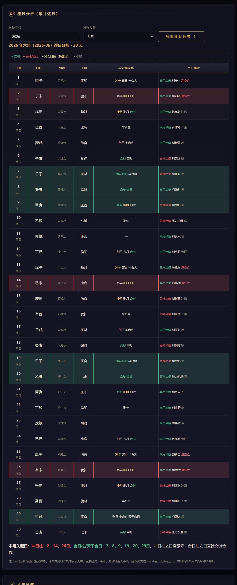
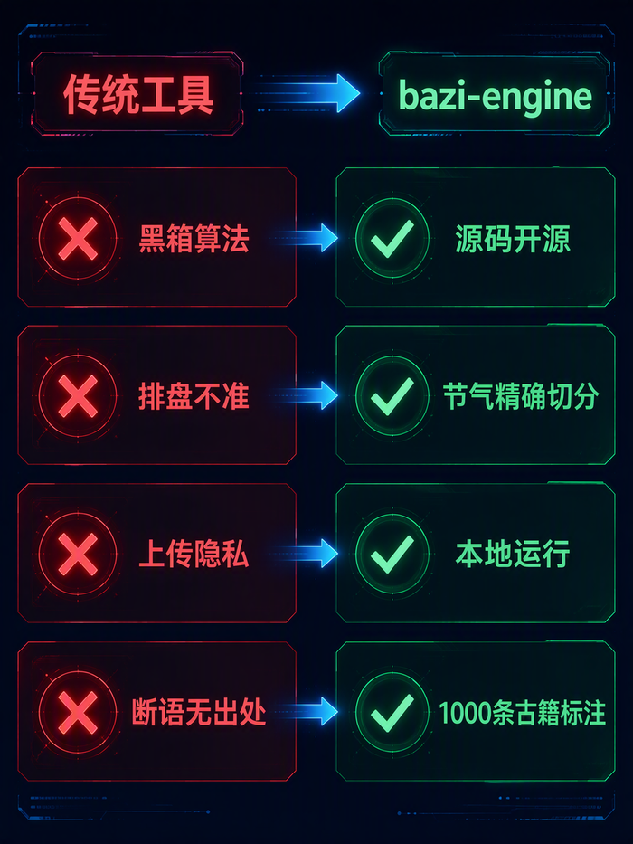
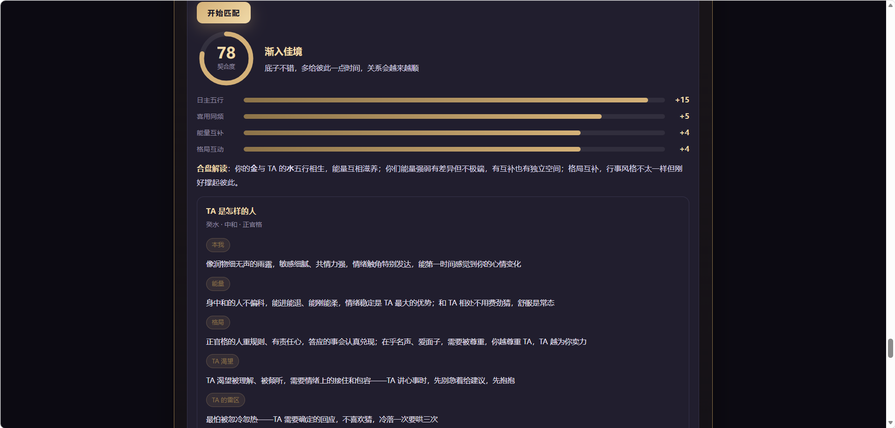
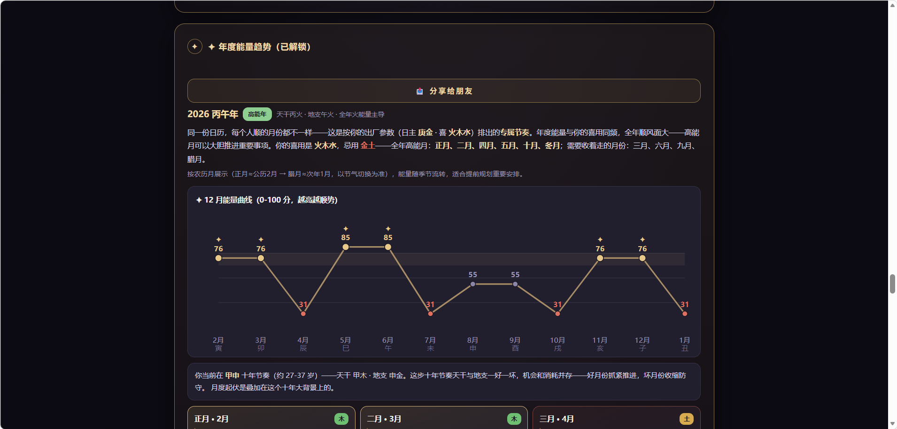
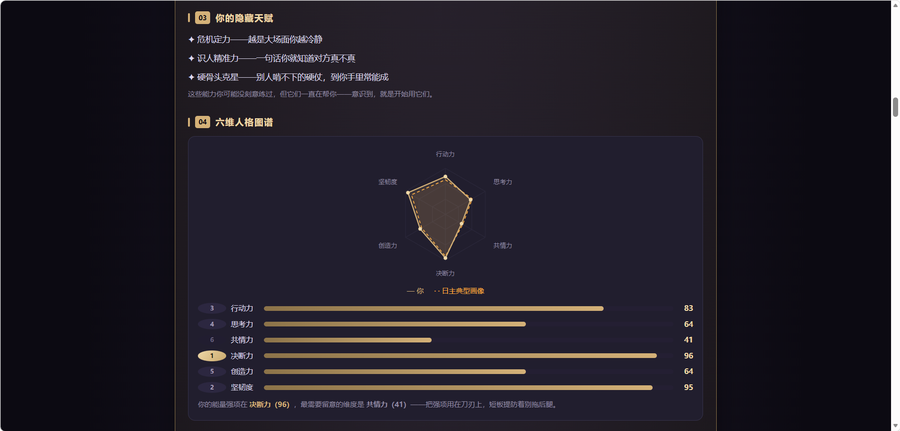
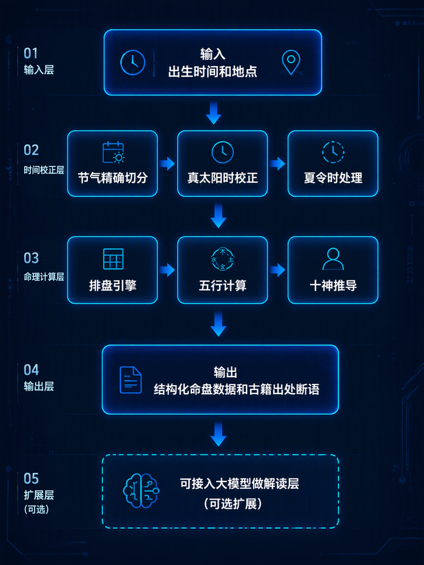

# bazi-engine · 四柱八字命理引擎

一个开箱即用的八字排盘与命理分析 Skill：输入出生信息，自动排出四柱八字、大运流年，并参照经典命理典籍给出带出处的专业解读。

[](https://github.com/ruanxiaoer888/bazi-engine)
[](https://github.com/ruanxiaoer888/bazi-engine/actions)
[](LICENSE)
[](https://skillhub.cn)
[](https://clawhub.ai/ruanxiaoer888/skills/baizi-engine)

> **English**: [README.en.md](README.en.md)  
> **GitHub**: https://github.com/ruanxiaoer888/bazi-engine  
> 🔗 **在线体验**：**[本初 · benchu.xiaoerpro.com](https://benchu.xiaoerpro.com/)** — 基于本引擎的 C 端在线产品

> 单文件离线运行，无任何外部依赖；排盘精确至节气时刻。

## 为什么是引擎？

大多数"AI 算命"产品让大语言模型直接**猜**四柱——而 LLM 恰恰不擅长历法计算。**bazi-engine 从不猜测**：排盘是确定性的、可测试的代码。

- 年柱精确到**立春时刻**，月柱精确到**节气时刻**（基于 206 年 1895–2100 预验证节气数据）
- 日柱按固定六十甲子递归，从规范基准日推算
- 晚子时（23:00+）翻日、真太阳时校正、大运精确至出生时刻

**同一出生数据，永远排出同一张盘。**

## 功能特性

- **排盘引擎**：四柱八字、十神、藏干、纳音、大运（精确至出生时刻起运）、流年、流月、流日
- **流日分析**：任意月份逐日 30 天，每日干支 / 十神 / 与命局冲合刑害 / 空亡 / 喜忌 / 十二长生，自动标记关键日
- **六亲详解**：父母 / 配偶 / 子女 / 兄弟分项分析，宫位为体、十神为用
- **合婚评分**：七大维度综合评分
- **五行补救**：喜用神、调候用神（古籍）、五行缺失与补救建议
- **神煞速查**：24 项吉凶星曜按命中展示
- **三式宫位**：胎元、命宫、身宫
- **断语可追溯**：1000 条断语，每条标注古籍出处（古代命理典籍）与行动建议

<p align="center">
  
  <br/>
  <em>引擎深度能力示例：单月逐日 30 天分析（每日干支 / 十神 / 冲合刑害 / 空亡 / 喜忌 / 十二长生）</em>
</p>

### 为什么选 bazi-engine？

<p align="center">
  
  <br/>
  <em>开源 · 节气精确切分 · 本地零依赖 · 1000 条古籍溯源断语</em>
</p>

## 产品生态

| | 项目 | 说明 |
|---|---|---|
| 🧩 | **bazi-engine**（本仓库） | 开源排盘引擎底座：Skill + 单文件 UI + 独立 JS 库（**代码 MIT / 数据 CC BY-NC-SA 4.0**），面向开发者与命理师 |
| 📦 | **Skill 市场分发** | 已上架 [ClawHub](https://clawhub.ai/ruanxiaoer888/skills/baizi-engine)（OpenClaw 官方市场）与 [SkillHub](https://skillhub.cn)（腾讯），AI 助手一键安装即用 |
| 🚀 | **[本初](https://benchu.xiaoerpro.com/)** | 作者自有的 C 端在线产品：AI 八字报告（排盘 / 合婚 / 流年），付费解锁，微信支付 |

**开源 → 商业闭环**：引擎开源于 GitHub 供社区使用与二次开发；C 端产品「本初」是作者自有的商业落地，与引擎共用同一确定性排盘内核。**C 端作为权利人可自用同一内核与数据**（作者对自有代码与数据享有完整权利）；**第三方**使用本仓库仍受双许可约束：代码 MIT、数据 [CC BY-NC-SA 4.0](LICENSE-DATA)，商业使用需另行取得授权。开源获得社区打磨，产品验证商业价值，互相成就。

<p align="center">
  
  <br/>
  <em>排盘结果：四柱命盘 + 五行能量 + 人格解读（以示例命盘展示）</em>
</p>
<p align="center">
  
  
  <br/>
  <em>双人匹配（合婚评分）· 年度能量趋势（逐月提醒）</em>
</p>
<p align="center">
  
  <br/>
  <em>深度报告示例：六维人格图谱（决策力 / 坚韧性等量化评估）</em>
</p>

## 快速开始

### 👤 普通用户 —— 直接体验

- **AI 助手**：从 [ClawHub](https://clawhub.ai/ruanxiaoer888/skills/baizi-engine)（OpenClaw 官方市场）或 SkillHub（腾讯）一键安装本 Skill，直接自然语言对话排盘（见下方「AI 助手」）
- **在线**：访问 [本初 · benchu.xiaoerpro.com](https://benchu.xiaoerpro.com/)（付费报告，微信支付）
- **离线**：浏览器打开 `ui/index.html`（单文件零依赖，`file://` 即可运行）

### 🧑‍💻 开发者 —— 接入引擎

`engine/engine.dist.js` 是独立的 UMD 引擎库（零依赖，导出 104 个 API），浏览器 / Node 双端可用：

```html
<!-- 浏览器 -->
<script src="engine/engine.dist.js"></script>
<script>
  // 性别参数须为 '男' / '女'；applyDst 回拨夏令时（1986-1991 年中国曾实行）
  const d = window.BaziEngine.applyDst(1990, 5, 15, 10, 0);        // {y:1990,m:5,d:15,hh:9,mm:0,dst:1}
  const c = window.BaziEngine.paipan('李明远', '男', 1990, 5, 15, d.hh, d.mm, '广州市', 'yes');
  console.log(c.yg, c.mg, c.dg, c.hg); // 庚午 辛巳 庚辰 庚辰
</script>
```

```js
// Node.js
const BaziEngine = require('./engine/engine.dist.js');
const d = BaziEngine.applyDst(1990, 5, 15, 10, 0);
const c = BaziEngine.paipan('李明远', '男', 1990, 5, 15, d.hh, d.mm, '广州市', 'yes');
console.log(c.yg, c.mg, c.dg, c.hg); // 庚午 辛巳 庚辰 庚辰
```

核心 API：`paipan`（排盘）/ `paipanStrict`（排盘，参数非法时抛错）/ `matchRules`（断语匹配）/ `validateCtx`（ctx 体检）/ `applyDst`（夏令时校正）/ `lunarToSolar`（农历转阳历）/ `calcShenSha`（神煞）/ `getDaYun`（大运）等。

**排盘失败怎么拿到原因（v1.3.12 起）**：`paipan()` 沿用旧契约——参数非法时返回 `null`（浏览器同时弹窗提示，不再静默）；失败原因通过 `getLastError()` 读取，返回 `{code, message, detail}`：

| code | 含义 |
|---|---|
| `INVALID_NUMBER` | 日期/时间含非数字（如 `undefined`、`''`） |
| `YEAR_OUT_OF_RANGE` | 年份超出节气库范围（1895-2100） |
| `INVALID_MONTH` / `INVALID_HOUR` / `INVALID_MINUTE` | 月 1-12 / 时 0-23 / 分 0-59 |
| `INVALID_DATE` | 日期不存在（如 2 月 30 日） |
| `INVALID_GENDER` | 性别非 `'男'` / `'女'` |
| `TRUESUN_OUT_OF_RANGE` | 真太阳时校正后跨出节气库范围 |

```js
const c = BaziEngine.paipan('李明远','男',1990,13,15,10,0,'','no'); // null
const e = BaziEngine.getLastError();   // {code:'INVALID_MONTH', message:'月份需为 1-12', detail:{m:13}}
// 需要 fail-fast 的服务端直接用严格版：
try { BaziEngine.paipanStrict('李明远','男',1990,13,15,10,0,'','no'); }
catch (err) { console.log(err.code, err.message); }  // INVALID_MONTH 月份需为 1-12
```

非致命降级走 `getLastWarning()`：`truesun='yes'` 但出生地不在内置 724 城经度表（或未提供）时，真太阳时会被跳过、按北京时间出盘，此时返回 `{code:'SOLAR_TIME_SKIPPED', message, detail:{place, cityCount}}`。**这是最容易悄悄算错的一处，服务端建议判空后提示用户核实出生地。**

**用自己的排盘系统？先跑 ctx 体检（v1.3.14 起）**：把你自己排盘的结果映射成 ctx 后，先体检一次再匹配：

```js
const ctx = { /* 你的排盘结果，字段见 ctx 契约 */ };
const v = BaziEngine.validateCtx(ctx);
if (!v.ok) {
  console.log(v.errors);   // [{field, message, got}] —— 必须修
  console.log(v.expected); // 引擎按四柱推算出的正确值（tens / dayMasterFull / sumFive / avgFive …）
}
console.log(v.warnings);   // 结果可能偏差，建议核对
const cats = BaziEngine.matchRules(ctx);   // 缺字段会抛可读错误，而非 Cannot read properties of undefined
```

`validateCtx` 最值钱的一条是**重算十神**：用引擎自己的 `tenGod()` 从「日柱天干 + 四柱天干」推一遍，与 `ctx.tens` 逐位比对。十神基准错是这份数据最常见的静默错误（实测命中数 122 → 113，全程零报错）。它还检查 `dayMasterFull`/`dmWx`/`dmYin` 与日柱是否自洽、`five` 之和是否等于 `sumFive`、喜用与忌神是否重叠、神煞项是否缺 `name` 等。

> 设计原则：**只做自洽性检查，绝不自动补值或纠正**——自动补值会把错误藏起来，比报错更危险。
> `matchRules` 入口只拦"缺了必然抛 `TypeError`"的字段（`pillars`/`tens`/`five`/`xiYong`/`jiYong`/`special`），
> 抛 `err.code = 'CTX_MISSING_FIELD'` 并列出字段名；其余字段的缺失行为保持不变（不改变既有调用方语义）。

### 🤖 AI 助手 —— 调用 Skill

通过支持 Skill 的 AI 助手（WorkBuddy / DeepSeek Harness / Codex / OpenClaw 等）调用本 Skill。

本 Skill 已上架两大 Skill 市场，均可一键安装：

- **ClawHub**（OpenClaw 官方市场）：[clawhub.ai/ruanxiaoer888/skills/baizi-engine](https://clawhub.ai/ruanxiaoer888/skills/baizi-engine)（平台导入为**一次性**，不会随 push 自动同步；发版后需用 `clawhub skill publish` 重新发布）

  ```bash
  openclaw skills install @ruanxiaoer888/baizi-engine
  ```

  > ⚠️ ClawHub 上另有一个**历史条目** `bazi-engine`（v1.0.0 / 504 条断语、描述中无数据许可声明），请勿安装；本仓库对应条目是 `baizi-engine`。

- **SkillHub**（腾讯，入口 <https://skillhub.cn>）：平台内搜索 `bazi-engine` 一键安装

安装后：

1. 告诉我你的出生信息：姓名、生日（阳历或农历均可）、出生时间、性别、出生地
2. 自动排盘并输出：四柱命盘 → 五行分析 → 大运流年 → 综合解读
3. 可继续追问流年 / 流月 / 流日 / 合婚 / 六亲等深入分析

### 示例对话

**Q：** 帮我算一下八字，1990年5月15日上午10点，男，广州出生。

**A：** 排出四柱（庚午 辛巳 庚辰 庚辰，含夏令时回拨 + 真太阳时校正说明）、五行分布、喜用神，并给出大运 8 步与当前流年解读（每条断语附古籍出处）。

**Q：** 看看我和她合不合，我1990年5月15日10点男广州，她1992年8月8日20点女北京。

**A：** 七大维度合婚评分（日主互补 / 五行相生 / 六亲对照 / 流年同步等），并标注相合与相冲之处。

**Q：** 2026年3月哪天适合谈合作？

**A：** 展开流日分析：逐日标注冲合日柱、喜用忌神日，汇总本月关键日，给出"冲日宜静守、合日宜社交"的建议。

## 技术说明

- **UI**：`ui/index.html` — 单文件离线（零外部依赖），内置 206 年节气数据 + 1000 条断语
- **构建**：`tools/build_ui.py`（Python）内联节气与断语库生成 UI
- **验证**：14 套回归脚本 + 6 道内容/可达性/交付/软化/数据表门禁，覆盖引擎库、农历、夏令时、输入容错、边界场景、报告质量与端到端用户视角，CI 自动执行

  <details>
  <summary>14 套回归脚本 + 6 道门禁清单（点击展开）</summary>

  ```
  tools/test_engine.js       引擎库直测（60 项：排盘/断语/神煞/大运/夏令时/真太阳时/排盘失败可读诊断）
  tools/test_lunar.js        农历模块（27 项）
  tools/test_ui.js           UI 功能回归
  tools/test_eval_state.js   旺衰状态机
  tools/test_p1_fixes.js     P1 修复回归
  tools/verify_sleep_rules.js 十二长生规则
  tools/verify_ux_e2e.js     端到端用户视角
  tools/test_dst.js          夏令时（41 项，含 applyDst 分钟透传与真太阳时联调）
  tools/test_liuri_v2.js     流日分析
  tools/test_liuyue_v2.js    流月分析
  tools/verify_edu_rules.js  学业规则
  tools/test_xiyong.js       喜用神
  tools/check_conflicts.js   反义矛盾检测
  tools/check_dup_hits.js    重复命中 + 逐字重复结论门禁（含 id 有效性校验）
  tools/check_same_condition.js  同条件多规则门禁（互斥 / 近重复结论）
  tools/check_reachability.js    断语可达性门禁（固定网格 + 极端样例盘）
  tools/check_content_lexicon.py 内容合规词表（绝对化 / 恐吓性 / 健康兜底 / 性别对冲）
  tools/check_compliance_equivalence.js 合规软化版等价性（C 端产物标识与命中结果不得被软化改动）
  tools/check_data_integrity.js  数据表完整性（724 城经度自解析+权威坐标 / 农历表结构+逐月递推 / 206 年节气）
  tools/build_release_zip.py --check 交付包契约（根文件齐全 / 禁入合规派生件 / 拒 docx 提取件）
  ```
  </details>
- **CI 门禁**：`.github/workflows/ci.yml`（GitHub Actions）在每次 push / PR 时自动构建 UI 与引擎 dist、校验断语库 JSON、跑 14 套回归 + 6 道门禁（内容词表 / 同条件多规则 / 可达性 / 数据表完整性 / 交付包契约干跑 / 合规软化等价）+ 命中分布审计，全绿方可合并——质量保障由机器人把关
- **跨平台一致性**：`.gitattributes` 强制构建产物与数据文件使用 LF 换行（Windows CRLF 曾导致 dist 字节不一致、MD5 无法跨平台对齐），保证本地 / CI / C 端三方字节一致
- **质检工具**：`audit_hit_distribution.js`（命中分布审查）、`check_dup_hits.js`（重复命中检测）、`check_conflicts.js`（反义矛盾检测）、`check_reachability.js`（可达性）、`check_same_condition.js`（同条件互斥）、`check_compliance_equivalence.js`（C 端软化版与 dist 行为等价）、`check_data_integrity.js`（城市经度 / 农历 / 节气三张表）

<p align="center">
  
  <br/>
  <em>处理链路：输入 → 时间校正（夏令时 / 真太阳时）→ 命理计算 → 结构化输出 → 可选 AI 解读</em>
</p>

## 目录结构

```
skill/SKILL.md           Skill 定义（引导式交互 + 分析流程）
ui/index.html            单文件离线界面
engine/engine.dist.js    独立引擎库（UMD：浏览器 / Node 双端可用）
tools/                   构建 / 测试 / 质检工具
kb/                      古籍原文 + 规则手册 + 断语库
.github/workflows/       CI 门禁（GitHub Actions：构建 + 回归 + 审计）
.gitattributes           LF 换行规范（跨平台产物一致性）
```

## 免责声明

本工具基于传统命理典籍（子平法）进行排盘与推演，结果仅供文化研究与娱乐参考，不构成医疗、投资、法律等任何专业建议。命理之说，信则有，不信则无，请理性看待。

## 数据溯源与许可标记

断语库（`kb/04-rules-db/rules.json`）**预留了溯源机制**：商业授权交付版本会内嵌来源标记（嵌入位置不公开），用于识别未获授权的整库搬运并为维权取证提供依据。

> ⚠️ **现状说明**：当前开源版本**尚未生成**指纹清单（本地私密清单 `.fingerprints.json` 不存在），因此请勿将上一段理解为"当前开源数据已可取证"。授权客户以授权协议附件中的交付版本与清单为准。

## License

本仓库采用**双许可**结构：

- **代码**（排盘引擎 / UI 逻辑 / 构建测试脚本 / Skill 定义）：[MIT](LICENSE) — 自由使用
- **数据**（`kb/` 断语库与古籍汇编等）：[CC BY-NC-SA 4.0](LICENSE-DATA) — 署名 · 非商业 · 相同方式共享（古籍原文属公有领域，可自由引用）
- **复合产物**（`ui/index.html`、`engine/engine.dist.js`）：**同一文件内"代码部分 MIT + 内联的 1000 条断语数据 CC BY-NC-SA 4.0"**。下载/引用这两个文件不等于获得断语数据的商用许可。

> **商业边界**：「本初」为作者自有商业产品（作者对自有代码与数据享有完整权利）；**第三方**使用本仓库仍按上方双许可执行（代码 MIT / 数据 CC BY-NC-SA 4.0），商业授权请联系作者。
>
> **市场分发**：本 Skill 在 [ClawHub](https://clawhub.ai/ruanxiaoer888/skills/baizi-engine) / [SkillHub](https://skillhub.cn) 等市场分发时同样适用上述双许可。**平台页面显示的 License 字段（ClawHub 因平台规则强制显示为 MIT-0）仅为平台元数据，不构成对数据部分的授权**；与本仓库不一致时，以 [LICENSE](LICENSE) / [LICENSE-DATA](LICENSE-DATA) 为准。
>
> 双许可边界、第三方来源清单（[THIRD-PARTY.md](THIRD-PARTY.md)）与商业授权说明详见 [LICENSE-DATA](LICENSE-DATA)。

## 支持作者

如果本项目对你有帮助，欢迎 [Star ⭐](https://github.com/ruanxiaoer888/bazi-engine) 或在 [本初](https://benchu.xiaoerpro.com/) 体验付费报告；商业授权 / 定制合作 / 反馈建议请联系作者：

<p align="center">
  
  <br/>
  <em>微信：<code>feizi6651</code>（扫码或搜索添加）· 公众号：AI 知识分享</em>
</p>
